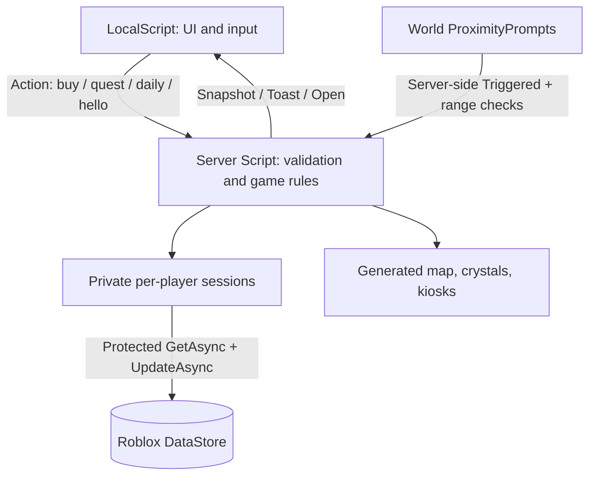

# Architecture

Starfall is deliberately installable with just **two Luau scripts**, one server script and one client script. The scripts are organized into labeled service functions rather than requiring 15 ModuleScripts for an introductory Roblox Studio setup.

## Flow

### Single network channel

`ReplicatedStorage.StarfallNetwork` is created by the server. The client sends the following actions:

| Action | Value | Validation |
|---|---|---|
| `hello` | none | Session exists and finished loading; sends snapshot |
| `buy` | upgrade ID | Allowlisted IDs, server-owned prices and balance, capped levels, action cooldown |
| `quest` | quest ID | Allowlisted IDs, server-owned progress, one-time reward, action cooldown |
| `daily` | none | UTC date, one reward per day, action cooldown |

The **client cannot award itself credits**. Gathering and selling happen through Roblox `ProximityPrompt.Triggered` on the server, with a distance check. Exploiters may fire client-exposed events, so every critical decision must be server-owned.

### Session data

The server keeps a private session per player:

- `coins`, `energy`, `collected`, `sold`
- `upgrades.pack`, `upgrades.power`, `upgrades.boots`
- `daily.day`, `daily.claimed`
- `quests.day`, `quests.progress`, `quests.claimed`

Values are clamped on load to expected numeric ranges. UTC rollover resets daily quests. `sync` sends a **sanitized view** to the HUD; private session tables never live in ReplicatedStorage.

### Saving and shutdown

- Load with `GetAsync` wrapped in `pcall`.
- Save dirty sessions approximately every 75 seconds with `UpdateAsync` wrapped in `pcall`.
- Save on player removal and during `BindToClose`.
- **Important:** if a load fails, saving is turned off for that session. The server does not overwrite a potentially valid existing record with an empty profile.
- No cross-server session lock is implemented. Add a mature profile/session management library before shipping a high-value economy or trading game.

### Map

The map is generated on server start under `Workspace.StarfallWorld`:

- Central town square (spawn area)
- SELL ENERGY kiosk
- UPGRADE SHOP kiosk
- DAILY REWARD kiosk
- QUEST BOARD kiosk
- PET SANCTUARY kiosk
- WORLD PORTAL kiosk
- Five crystal zones, each with 12 crystals

No external assets required. Zone crystal spawns are fixed and server-shared.

### Performance

The world contains 36 interactable crystals. Each has an independent server callback and a nine-second respawn. Scaling to thousands of collectibles would require pooling and more centralized scheduling.

## Version 2 additions

- All pet purchases, pet equipment, region unlocks, and bonus yields are calculated and authorized by the server. The player attribute `StarfallPet` only exposes the equipped pet ID for visual replication.
- New persistent fields: `pets.owned`, `pets.equipped`, `unlocked.frost`, `unlocked.nebula`, and `upgrades.market`. Missing fields in old v1 saves are defaulted without changing the DataStore name.
- The seven-tab client renders server-provided shop/pet/world snapshots; it never sends currency amounts.
- Pet models are client-side cosmetic parts, with a separate model displayed for every player with an equipped-pet attribute.
- The in-menu leaderboard reads Roblox `leaderstats` for the current server only. No OrderedDataStore global rankings are claimed.
- New regions are not hard collision-locked; the server rejects harvesting for players who have not paid the unlock cost.
